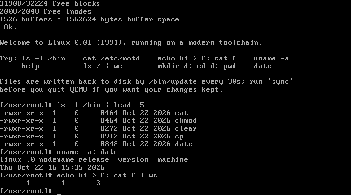

# Linux 0.01, on a modern toolchain

This is Linus Torvalds' Linux 0.01 from September 1991, taken from the
[kernel.org historic archive](https://cdn.kernel.org/pub/linux/kernel/Historic/linux-0.01.tar.gz),
patched so it builds with a current GCC and binutils and boots to a working
shell in QEMU.

The first commit in this repository is the untouched 1991 tarball, so
`git diff <first commit>` shows every change made.



## Quick start

You need `gcc` and binutils that can target 32-bit x86 (any x86-64 Linux
distribution's normal packages; no multilib or libc needed), GNU `make`,
`python3` and `qemu-system-i386`.

```sh
make run          # build everything and boot it in a QEMU window
make run-curses   # same, in the terminal (Alt-2 for the QEMU monitor, then "quit")
make test         # headless boot + scripted shell session, checks the output
```

`make` builds two images:

- **`Image`**: a 1.44 MB boot floppy holding the boot sector and the kernel.
- **`hd.img`**: a 32 MB hard disk with a single Minix partition, which is the
  root file system.

## What you can do

The kernel runs `/bin/sh` on the console. The shell supports pipes,
redirection (`<`, `>`, `>>`), background jobs (`&`), `;`, `&&` and `||`,
quoting, `$VAR` / `$?` / `$$`, and `*` and `?` globbing. Its built-in
commands are `cd`, `pwd`, `export`, `unset`, `exit` and `help`.

These programs are in `/bin`:

| | |
|---|---|
| files | `ls [-la]` `cat` `cp` `mv` `rm [-rf]` `ln` `mkdir` `rmdir` `touch` `chmod` |
| text | `echo` `wc [-lwc]` `head [-n]` |
| system | `uname` `date` `sync` `kill` `sleep` `env` `clear` `update` `hello` |

Things to try:

- `echo hi > f; cat f`
- `ls / | wc`
- `mkdir d; cd d; pwd`
- `cat > notes`, then type some lines and end with Ctrl-D

Ctrl-C interrupts the running program. If you `exit` the shell, init
starts a new one.

The 1991 kernel never writes the buffer cache back on its own. The `update`
daemon (started by init, as Linus intended) runs `sync` every 30 seconds.
Run `sync` yourself before closing QEMU if you want to keep your changes.
`make hd.img` rebuilds the disk from scratch.

## What was changed, and why

The kernel was written for gcc 1.x, the a.out object format and Minix's
`as86`. Very little of it actually depended on that. The changes fall into
a few groups.

**Build.**

- New Makefiles, all sharing `Makefile.header`.
- ELF objects are linked at address 0 by `tools/system.ld` and flattened with
  `objcopy`.
- `-fleading-underscore` keeps a.out's `_symbol` naming, so the hand-written
  assembly links unchanged.
- `tools/build.c` now glues raw binaries together instead of stripping
  Minix/a.out headers.

**Boot sector.** `boot/boot.s` was translated from as86 to GNU as
(`.code16`). It is the same code with the same comments.

**Inline assembly.** gcc 1.x let an `asm` statement clobber its own input
registers and write to memory it had declared as input-only. Modern gcc
either rejects that or quietly miscompiles it. These were the real bugs:

- `INC_PIPE` made every pipe return the same byte forever.
- `get_base` read through a register it had already overwritten.

All of the kernel's asm got correct constraints:

- dummy outputs for registers it clobbers
- `"memory"` where it writes memory
- `"=&"` where outputs must not share a register with an input

`<string.h>` is now plain C instead of 400 lines of string-instruction asm.
`<stdarg.h>` uses the compiler builtins.

**Small fixes needed to run at all:**

- *Disk access.* The IDE status register is per drive, so `hd.c` now selects
  the drive before polling it. Without that, the BIOS's last probe of the
  absent second drive reads back as "not ready".
- *Direction flag.* gcc-compiled code assumes the CPU's direction flag is
  clear, so the kernel clears it at every entry from assembly.
- *Keyboard.* `keyboard.s` cleared only `%al` before using `%eax` as a table
  index.
- *Disk geometry.* `include/linux/config.h` has a `QEMU_HD` configuration
  matching the emulated disk. Root is `/dev/hd1`.

**Fixes for real bugs that only show up today:**

- The CMOS clock stores two-digit years, which 0.01 read as 19xx (Y2K).
- The month was decremented while still in BCD, which breaks dates in
  October to December.
- The `drive_busy` precedence bug and the `WIFEXITED` missing parenthesis
  are fixed.

**Small quality-of-life changes:**

- A US keyboard map by default. Linus' Finnish one is kept: assemble
  `kernel/keyboard.s` with `--defsym KBD_FINNISH=1`.
- init starts a new shell when the old one exits, as in Linux 0.11.

Everything else is the 1991 code. That includes:

- the 8 MB memory limit and the 64 MB-per-process segments
- the `0133` umask
- `uname` reporting `linux .0`
- Minix-v1-only file systems with 14-character names
- no `rename()`, symlinks or `mknod()`

## The userland (`userland/`)

In 1991 Linux borrowed its programs from Minix. To get a shell, this
repository has its own small userland:

- `userland/lib`: a small C library (syscall stubs, stdio, malloc,
  directories, time) built against the kernel's own `include/`, which was
  also the libc header set at the time.
- `userland/bin`: the shell and the programs listed above.
- `userland/mkaout.py`: converts the linked ELF files into the ZMAGIC a.out
  format that 0.01's `exec()` loads. Each program is linked at address 0,
  with its text and data at file offset 1024.
- `tools/mkrootfs.py`: writes the disk image (MBR, Minix v1 file system,
  device nodes from `userland/devices`) without needing root, loop devices
  or `mkfs.minix`.

To add a program, drop `foo.c` into `userland/bin`, add `foo` to `PROGS`
in `userland/Makefile`, and run `make hd.img`.

## Running elsewhere

Anything that emulates an IBM PC/AT should work: QEMU, Bochs or 86Box. It
needs a BIOS that can boot a floppy, an IDE disk on the legacy ports
(0x1F0, IRQ 14) and a VGA text console.

Real modern hardware almost certainly won't work. It would need legacy
BIOS boot, a disk controller in IDE compatibility mode, and the exact disk
geometry hard-coded in `config.h`. 0.01 also uses no more than 8 MB of RAM.

If you change the disk geometry, change it in two places: `HD_TYPE` in
`include/linux/config.h` and `HD_CYLS`/`HD_HEADS`/`HD_SECS` in the
`Makefile`.

## Debugging

`tools/system` is an ELF file with symbols. To debug the kernel in QEMU:

```sh
make run QEMUEXTRA="-s -S"         # in one terminal
gdb tools/system -ex 'target remote :1234'
```

C symbols carry a leading underscore (`b _schedule`).
